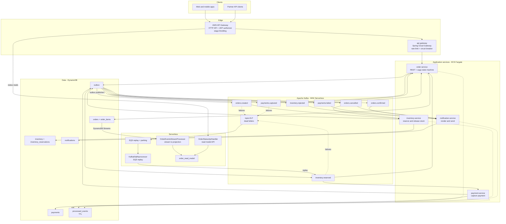
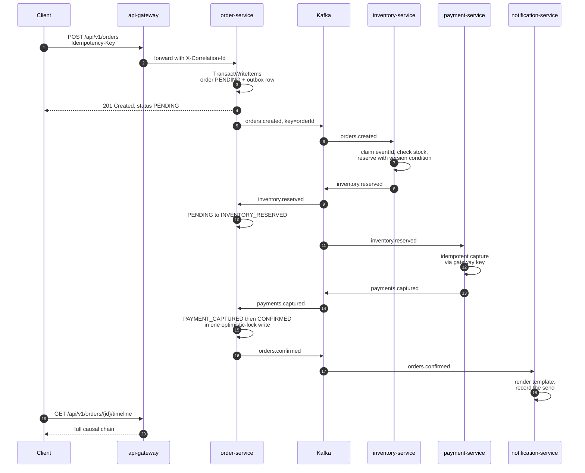
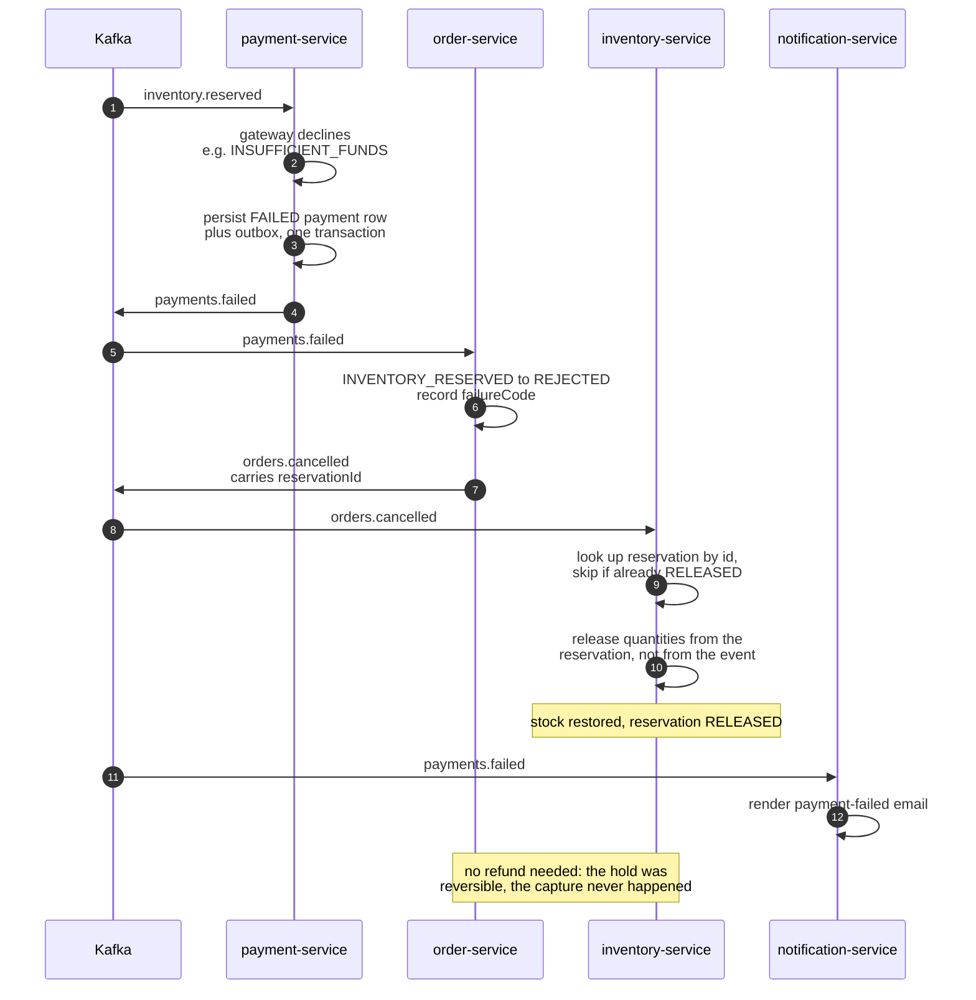
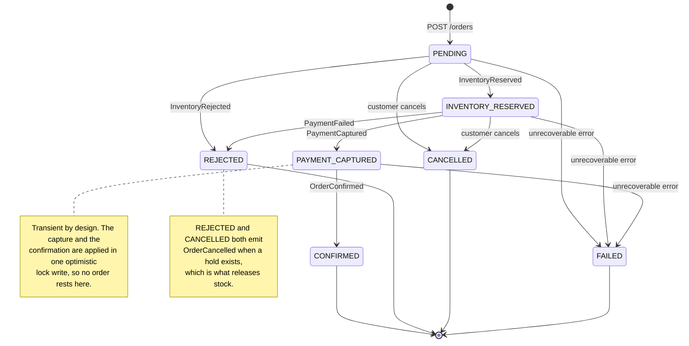
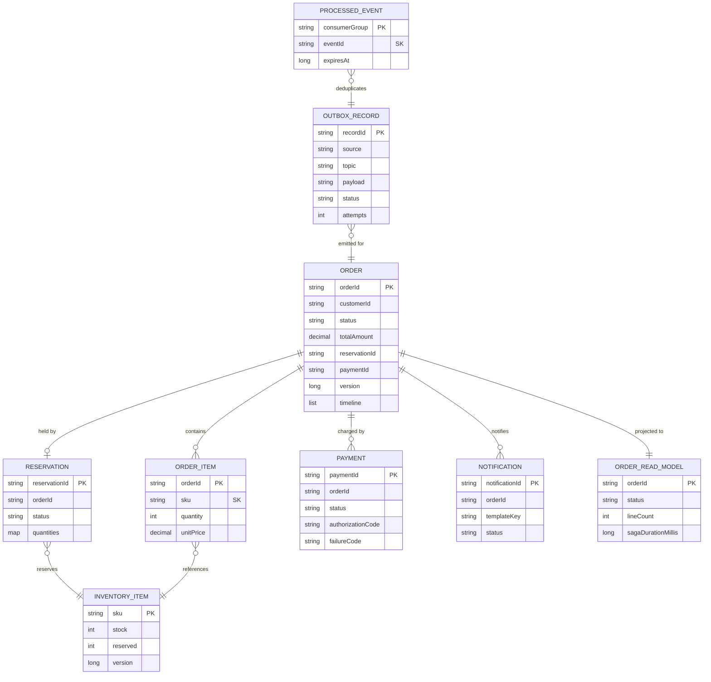
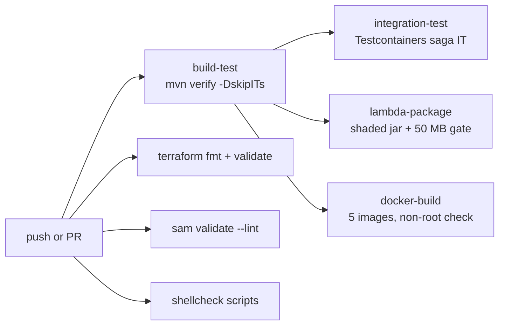

# cloud-order-processing-system

Event-driven order processing on Java 21 and Spring Boot 3.3: five services run a choreographed
Kafka saga (hold stock, capture payment, confirm, or compensate) over DynamoDB, with a
transactional outbox, idempotent consumers and a Lambda read path, deployable with Terraform or SAM.

[](https://github.com/vishnu-ing/cloud-order-processing-system/actions/workflows/ci.yml)

## Why

An order touches three owners of state: the order itself, the stock it holds and the payment that
pays for it. The textbook answer, one distributed transaction across all three, needs a two-phase
commit coordinator, blocks every participant while it holds locks, and is not available anyway:
neither DynamoDB nor a real payment gateway enlists in an XA transaction.

This project replaces that transaction with a **saga**: a sequence of local transactions, each
with a defined compensating action. Stock is *held*, then payment is *captured*; if the capture
fails, the hold is *released*. Each step is ACID inside its own service (one DynamoDB
`TransactWriteItems` covering the aggregate and its outbox row), and the system as a whole is
eventually consistent with an explicit, tested rollback path. `POST /api/v1/orders` returns as soon
as the order is stored as `PENDING`; everything after that happens over Kafka, with no synchronous
service-to-service calls in the write path.

## Features

**Saga and consistency**
- Choreographed saga across order, inventory, payment and notification services, including a real
  compensation path (payment failure releases the held stock)
- Transactional outbox in every producing service: the aggregate write and the event row commit in
  one `TransactWriteItems`
- Idempotent consumers keyed on `(consumerGroup, eventId)` with a DynamoDB conditional put and a
  7-day TTL
- `Idempotency-Key` on `POST /api/v1/orders`: a retried request returns the original order with
  `200` instead of creating a second one
- Optimistic concurrency with `@DynamoDbVersionAttribute` and jittered retry on conflict
- An explicit order state machine; an illegal transition throws and is dead-lettered, never
  silently applied

**Reliability and operations**
- Exponential back-off retries, then `<topic>.DLT` dead-letter topics carrying Spring's failure
  headers
- Retryable / non-retryable exception split, so a poison message dead-letters on the first attempt
- SQS-triggered Lambda reprocessor for controlled DLQ replay, with an attempt cap and a parking queue
- Correlation id carried from the HTTP header into the event envelope, Kafka headers, MDC and every
  log line
- Micrometer counters and timers per saga step on `/actuator/prometheus`
- Six CloudWatch alarms, each mapped to a section of [`docs/RUNBOOK.md`](docs/RUNBOOK.md)

**API and data**
- Cursor pagination over DynamoDB `LastEvaluatedKey`: no offsets, no scans
- RFC 7807 `application/problem+json` errors that carry the correlation id
- A saga timeline endpoint that rebuilds an order's causal chain from one `GetItem`
- Serverless read path: DynamoDB Streams to a Lambda projection, served by a Lambda HTTP handler

**Infrastructure**
- Docker Compose stack: KRaft Kafka, kafka-ui, LocalStack and the five services
- Terraform for the AWS topology: VPC, MSK Serverless, ECS Fargate on Graviton, Lambda, HTTP API,
  SQS, IAM and alarms
- An AWS SAM template for the serverless slice on its own
- Multi-stage, non-root, layered-jar Docker images
- GitHub Actions: build and unit tests, Testcontainers integration test, image build matrix, Lambda
  jar size gate, `terraform validate`, `sam validate --lint`, shellcheck

## Architecture



| Component | Role | Port (native / compose host) |
| --- | --- | --- |
| `api-gateway` | Spring Cloud Gateway edge: correlation id, per-client token-bucket rate limit, circuit breakers, optional JWT validation | 8080 / 8080 |
| `order-service` | REST API, order aggregate and state machine, reacts to inventory and payment outcomes | 8081 / 8091 |
| `inventory-service` | Holds stock with conditional writes; releases it from the reservation on cancellation | 8082 / 8092 |
| `payment-service` | Captures payment through a deterministic simulated gateway | 8083 / 8093 |
| `notification-service` | Renders a template per terminal event and records the send (SES is simulated) | 8084 / 8094 |
| `lambda-functions` | Stream projection, read-model HTTP handler and DLQ replay, packaged as one shaded jar | AWS only |
| `common-events` | Event envelope and sealed `DomainEvent` contract, outbox, idempotency guard, Kafka error policy | library |

Each service owns its tables; the only runtime coupling is the event contract in `common-events`.
The `outbox` table is shared by the three producing services, and every row records the service
that wrote it so each publisher drains only its own rows. The full reasoning (service boundaries,
why choreography rather than orchestration, the failure taxonomy, capacity and cost) is in
[`docs/ARCHITECTURE.md`](docs/ARCHITECTURE.md).

### Saga flow: happy path

Every hop is an event on a real topic; nothing here is a synchronous call.



### Compensation flow: payment failure

The rollback is not an exception handler; it is another saga step with its own event.



### Order state machine



The graph lives in `OrderStateMachine` as an `EnumMap` of allowed transitions. Anything else throws
`IllegalStateTransitionException`, a `NonRetryableException`, so it is dead-lettered immediately: in
a choreographed saga an illegal transition means events arrived in an order the design did not
anticipate, and that belongs in a DLQ with its payload.

## Quick start

### Prerequisites

| Tool | Version | Needed for |
| --- | --- | --- |
| JDK | 21 (any 21+ builds it; the bytecode targets 21) | building and running the services |
| Maven | 3.9+ | the build (there is no wrapper) |
| Docker + Compose | 24+ / v2 | the Compose stack and the integration test |
| AWS CLI | v1 or v2 | `scripts/create-tables.sh` when you run without Docker |
| Terraform / AWS SAM CLI | 1.6+ / 1.120+ | AWS deployment only |

### Build and run the unit tests (no Docker, no network services)

```bash
git clone https://github.com/vishnu-ing/cloud-order-processing-system.git
cd cloud-order-processing-system
mvn -B verify -DskipITs
```

This compiles all seven modules, runs the 45 unit tests and packages the five Spring Boot jars and
the shaded Lambda jar:

```text
[INFO] Tests run: 16, Failures: 0, Errors: 0, Skipped: 0      <- common-events
[INFO] Tests run: 24, Failures: 0, Errors: 0, Skipped: 0      <- order-service
[INFO] Tests run: 5, Failures: 0, Errors: 0, Skipped: 0       <- lambda-functions
[INFO] BUILD SUCCESS
```

### Run the whole platform with Docker Compose

Requires Docker. Compose builds the five service images and starts Kafka, kafka-ui and LocalStack;
`create-tables.sh` runs as a LocalStack `ready.d` hook and `create-topics.sh` runs in the
`kafka-setup` container, so tables and topics exist without manual steps.

```bash
docker compose up -d --build
docker compose ps        # the service images have readiness healthchecks
```

| What | URL |
| --- | --- |
| API gateway | <http://localhost:8080> |
| kafka-ui | <http://localhost:8081> |
| LocalStack | <http://localhost:4566> |
| order-service health / metrics | <http://localhost:8091/actuator/health>, `/actuator/prometheus` |
| Swagger UI | <http://localhost:8091/swagger-ui.html> |

### Run it without Docker

The same stack runs natively against a single-node Kafka and DynamoDB Local. From the repository
root, after `mvn -B verify -DskipITs`:

```bash
# Kafka 3.8 in KRaft mode on localhost:9092
curl -sSLO https://archive.apache.org/dist/kafka/3.8.1/kafka_2.13-3.8.1.tgz
tar xzf kafka_2.13-3.8.1.tgz
kafka_2.13-3.8.1/bin/kafka-storage.sh format -t "$(kafka_2.13-3.8.1/bin/kafka-storage.sh random-uuid)" \
  -c kafka_2.13-3.8.1/config/kraft/server.properties
kafka_2.13-3.8.1/bin/kafka-server-start.sh -daemon kafka_2.13-3.8.1/config/kraft/server.properties

# DynamoDB Local on localhost:8000
curl -sSLO https://d1ni2b6xgvw0s0.cloudfront.net/v2.x/dynamodb_local_latest.tar.gz
mkdir -p dynamodb-local && tar xzf dynamodb_local_latest.tar.gz -C dynamodb-local
(cd dynamodb-local && java -Djava.library.path=./DynamoDBLocal_lib -jar DynamoDBLocal.jar \
  -inMemory -port 8000 > ../dynamodb-local.log 2>&1 &)

# Topics, tables and demo stock
PATH="$PWD/kafka_2.13-3.8.1/bin:$PATH" ./scripts/create-topics.sh
export AWS_ACCESS_KEY_ID=test AWS_SECRET_ACCESS_KEY=test AWS_REGION=us-east-1
AWS_ENDPOINT_URL=http://localhost:8000 ./scripts/create-tables.sh

# The five services, local profile
export SPRING_PROFILES_ACTIVE=local KAFKA_BOOTSTRAP_SERVERS=localhost:9092 \
       AWS_ENDPOINT_URL=http://localhost:8000
for svc in order-service:8081 inventory-service:8082 payment-service:8083 \
           notification-service:8084 api-gateway:8080; do
  name=${svc%%:*}
  SERVER_PORT=${svc##*:} java -jar "$PWD/$name/target/$name.jar" > "$name.log" 2>&1 &
done
```

Give the services about 20 seconds to start, then use the requests below on port 8080. To stop
everything:

```bash
pkill -f "$PWD/.*/target/.*\.jar"
pkill -f DynamoDBLocal.jar
kafka_2.13-3.8.1/bin/kafka-server-stop.sh
```

The downloads and the `*.log` files are ignored by git.

## Usage

The requests and responses below were captured from the native stack above.

**Create an order.**

```bash
curl -i -X POST http://localhost:8080/api/v1/orders \
  -H 'Content-Type: application/json' \
  -H "Idempotency-Key: $(uuidgen)" \
  -d '{
    "customerId": "cust-9f2a",
    "customerEmail": "dana@example.com",
    "currency": "USD",
    "lines": [
      { "sku": "SKU-BOOK-1",    "quantity": 2, "unitPrice": 42.50 },
      { "sku": "SKU-HEADSET-1", "quantity": 1, "unitPrice": 189.00 }
    ]
  }'
```

```text
HTTP/1.1 201 Created
Location: /api/v1/orders/f836c357-7fd0-4c0b-a4fd-7b05771c32b5
Content-Type: application/json
X-Correlation-Id: f456ba86-1b90-4b84-86cc-2b30d9d202f0

{"orderId":"f836c357-7fd0-4c0b-a4fd-7b05771c32b5","customerId":"cust-9f2a",
 "status":"PENDING","totalAmount":274.00,"currency":"USD",
 "correlationId":"f456ba86-1b90-4b84-86cc-2b30d9d202f0", ...}
```

Sending the same body with the same `Idempotency-Key` again returns `HTTP/1.1 200 OK` with the same
`orderId`.

**Watch the saga.** A couple of seconds later the order is `CONFIRMED`, and the timeline shows the
causal chain: each event's `causationId` is the `eventId` of the event that triggered it.

```bash
curl -s http://localhost:8080/api/v1/orders/f836c357-7fd0-4c0b-a4fd-7b05771c32b5/timeline | jq
```

```json
{
  "orderId": "f836c357-7fd0-4c0b-a4fd-7b05771c32b5",
  "status": "CONFIRMED",
  "events": [
    { "status": "PENDING", "eventType": "ORDER_CREATED",
      "eventId": "380de297-4feb-416b-b06c-9f4394794857", "causationId": null,
      "detail": "Order accepted with 2 line(s)", "occurredAt": "2026-10-26T00:11:35.596645Z" },
    { "status": "INVENTORY_RESERVED", "eventType": "INVENTORY_RESERVED",
      "eventId": "116328de-0532-4f06-ba73-501a843b30c3",
      "causationId": "380de297-4feb-416b-b06c-9f4394794857",
      "detail": "Stock reserved, reservationId=ac41582d-8f01-4204-a52e-80f67fb1f29e",
      "occurredAt": "2026-10-26T00:11:37.258721Z" },
    { "status": "PAYMENT_CAPTURED", "eventType": "PAYMENT_CAPTURED",
      "eventId": "6440beee-cee6-4f93-9bd1-6308d5470275",
      "causationId": "116328de-0532-4f06-ba73-501a843b30c3",
      "detail": "Payment captured, authorization=AUTH-2146D850",
      "occurredAt": "2026-10-26T00:11:37.745690Z" },
    { "status": "CONFIRMED", "eventType": "ORDER_CONFIRMED",
      "eventId": "d3decc9f-2f6a-46fe-b0b0-2870d0032c4a",
      "causationId": "6440beee-cee6-4f93-9bd1-6308d5470275",
      "detail": "Order confirmed", "occurredAt": "2026-10-26T00:11:37.745737Z" }
  ]
}
```

(Each event also carries the saga's `correlationId`, trimmed here.)

**The unhappy paths.** `SKU-LIMITED-1` is seeded with 2 units, and the simulated gateway declines
anything over 5000 (`PAYMENT_DECLINE_ABOVE`):

```bash
# Out of stock: ends REJECTED, nothing is charged.
curl -s -X POST http://localhost:8080/api/v1/orders -H 'Content-Type: application/json' \
  -H "Idempotency-Key: $(uuidgen)" \
  -d '{"customerId":"cust-9f2a","customerEmail":"dana@example.com","currency":"USD",
       "lines":[{"sku":"SKU-LIMITED-1","quantity":50,"unitPrice":129.00}]}' | jq -r .orderId

# Payment decline: stock is held, the capture fails, orders.cancelled releases the hold.
curl -s -X POST http://localhost:8080/api/v1/orders -H 'Content-Type: application/json' \
  -H "Idempotency-Key: $(uuidgen)" \
  -d '{"customerId":"cust-9f2a","customerEmail":"dana@example.com","currency":"USD",
       "lines":[{"sku":"SKU-LAPTOP-1","quantity":3,"unitPrice":2400.00}]}' | jq -r .orderId
```

```text
out of stock  {"status":"REJECTED","failureCode":"INVENTORY_REJECTED",
               "failureReason":"Insufficient stock for SKU-LIMITED-1"}
decline       {"status":"REJECTED","failureCode":"INSUFFICIENT_FUNDS",
               "failureReason":"Amount 7200.00 USD exceeds the authorised limit"}
              timeline: ORDER_CREATED -> INVENTORY_RESERVED -> PAYMENT_FAILED
                        ("Payment failed: ... — releasing stock")
inventory     SKU-LAPTOP-1 reserved: 0 before, 0 after (the 3-unit hold was released)
```

**Everything else.**

```bash
ORDER_ID=f836c357-7fd0-4c0b-a4fd-7b05771c32b5   # the confirmed order from above

# Cursor pagination: pass nextCursor back as ?cursor=
curl -s "http://localhost:8080/api/v1/orders?customerId=cust-9f2a&limit=2" | jq '.nextCursor'

# Cancel; a terminal order answers 409 with an RFC 7807 body
curl -s -X POST http://localhost:8080/api/v1/orders/$ORDER_ID/cancel \
  -H 'Content-Type: application/json' -d '{"reason":"changed my mind"}'
# {"type":"urn:problem-type:orders:illegal-state-transition","title":"Illegal order state transition",
#  "status":409,"detail":"Order ... cannot transition from CONFIRMED to CANCELLED",
#  "correlationId":"65d1fc5a-...","currentStatus":"CONFIRMED","requestedStatus":"CANCELLED"}

# Downstream health through the gateway's /internal routes
for s in inventory payment notification; do
  curl -s "http://localhost:8080/internal/$s/actuator/health" | jq -c "{service:\"$s\", status}"
done

# What the services stored (native stack: DynamoDB Local on :8000; Compose: LocalStack on :4566)
aws --endpoint-url http://localhost:8000 dynamodb scan --table-name notifications \
  --query 'Items[].{template:templateKey.S,status:status.S}'
```

The Postman collection in [`postman/`](postman/OrderProcessing.postman_collection.json) covers the
same requests, including one that polls the timeline until the saga reaches a terminal state. The
OpenAPI description is in [`docs/api/openapi.yaml`](docs/api/openapi.yaml).

## How it works

### Event contract

Every event is keyed by `orderId`, which gives total ordering per order while different orders
spread freely across partitions.

| Event | Topic | Producer | Consumers | Payload summary |
| --- | --- | --- | --- | --- |
| `OrderCreated` | `orders.created` | order-service | inventory-service | customerId, customerEmail, lines, totalAmount, currency |
| `InventoryReserved` | `inventory.reserved` | inventory-service | payment-service, order-service | reservationId, customerId, lines, totalAmount, currency |
| `InventoryRejected` | `inventory.rejected` | inventory-service | order-service, notification-service | reason, unavailableSkus |
| `PaymentCaptured` | `payments.captured` | payment-service | order-service | paymentId, reservationId, amount, currency, authorizationCode |
| `PaymentFailed` | `payments.failed` | payment-service | order-service, notification-service | paymentId, reservationId, failureCode, failureReason, retryable |
| `OrderConfirmed` | `orders.confirmed` | order-service | notification-service | customerId, customerEmail, paymentId, totalAmount, currency |
| `OrderCancelled` | `orders.cancelled` | order-service | inventory-service, notification-service | customerId, customerEmail, reservationId, reason |

Each topic has a `<topic>.DLT` sibling with one partition and 14-day retention. Payloads travel in
an `EventEnvelope`; this is the `inventory.reserved` record for the order above, read back from
Kafka:

```json
{
  "eventId": "116328de-0532-4f06-ba73-501a843b30c3",
  "eventType": "INVENTORY_RESERVED",
  "schemaVersion": 1,
  "correlationId": "f456ba86-1b90-4b84-86cc-2b30d9d202f0",
  "causationId": "380de297-4feb-416b-b06c-9f4394794857",
  "occurredAt": "2026-10-26T00:11:37.017004Z",
  "source": "inventory-service",
  "payload": {
    "orderId": "f836c357-7fd0-4c0b-a4fd-7b05771c32b5",
    "reservationId": "ac41582d-8f01-4204-a52e-80f67fb1f29e",
    "customerId": "cust-9f2a",
    "lines": [
      { "sku": "SKU-BOOK-1", "quantity": 2, "unitPrice": 42.50 },
      { "sku": "SKU-HEADSET-1", "quantity": 1, "unitPrice": 189.00 }
    ],
    "totalAmount": 274.00,
    "currency": "USD",
    "eventType": "INVENTORY_RESERVED"
  }
}
```

`eventId` is the deduplication key, `correlationId` is stable for the whole saga, and `causationId`
points at the event that caused this one, which is what makes the timeline a causal chain rather
than a log dump. `schemaVersion` lets a consumer reject a payload it does not understand instead of
guessing. Polymorphism is driven by the `eventType` property inside `payload`, so the JSON carries
no Java type hints and stays readable by non-JVM consumers; `EventJsonTest` round-trips every event
type through the Kafka serde to keep it that way.

### Data model

| Table | PK / SK | GSIs | Access patterns |
| --- | --- | --- | --- |
| `orders` | `orderId` | `customerId-createdAt-index`, `status-createdAt-index` | get one order; a customer's orders newest first; sweep for stuck sagas |
| `order_items` | `orderId` / `sku` | none | an order's lines |
| `inventory` | `sku` | none | sellable quantity; conditional reserve and release |
| `inventory_reservations` | `reservationId` | `orderId-index` | find the hold to release on cancellation |
| `payments` | `paymentId` | `orderId-index` | pre-capture duplicate check |
| `outbox` | `recordId` | `status-createdAt-index` | drain this service's `PENDING` rows oldest first |
| `processed_events` | `consumerGroup` / `eventId` | none (TTL on `expiresAt`) | consumer dedupe; `Idempotency-Key` replay |
| `notifications` | `notificationId` | none | what was sent, and its status |
| `order_read_model` | `orderId` | `customerId-updatedAt-index` | serverless status reads |



**Multi-table, not single-table.** Single-table design is the right default when one service owns
every access pattern. Here the table boundary is the service boundary: one shared table would mean
one IAM policy that cannot be scoped per service, one throttling blast radius and migrations that
need every service to deploy together. Within a service the design is single-table thinking:
`orders` embeds the saga timeline instead of joining, and `order_items` uses a composite key.

### Delivery guarantees

**At-least-once delivery, effectively-once processing.** The outbox publisher sends to Kafka
*before* marking a row `PUBLISHED`, so a crash in between causes a redelivery rather than a lost
event; a lost event would strand a saga, while a duplicate is only repeated work. `IdempotencyGuard`
then claims `(consumerGroup, eventId)` with a `PutItem` guarded by
`attribute_not_exists(consumerGroup)` before the handler runs, and releases the claim if the handler
throws so the Kafka retry can genuinely re-run. Handlers are also naturally idempotent (inventory
checks for an existing reservation, payment for an existing capture, the state machine treats a
re-applied transition as a no-op), which covers the one window the marker cannot: a crash between a
successful handler and a released claim.

**The outbox.** Writing the event row in the same `TransactWriteItems` as the aggregate collapses
"state changed" and "event queued" into one fact. The publisher runs on every replica; a conditional
`PENDING` to `PUBLISHED` update means two replicas may both send, but only one wins the flip, and
the duplicate is absorbed downstream.

**Ordering.** Kafka orders within a partition and every event is keyed by `orderId`, so one order's
events are strictly ordered. Different orders share no state except SKU counters, which are
protected by optimistic concurrency rather than by ordering.

**Optimistic concurrency.** `orders` and `inventory` carry `@DynamoDbVersionAttribute`, so every
write is conditional on the version that was read. Two saga events landing on the same order cannot
overwrite each other; the loser re-reads and retries. For inventory this is the difference between
overselling and not: two orders competing for the last unit serialise, and the second re-evaluates
availability.

### Retries, dead letters and replay

| Setting | Value | Why |
| --- | --- | --- |
| Consumer back-off | 500 ms, x2, capped at 10 s, 4 retries | about 16 s of retry budget per record, then dead-letter |
| Non-retryable | `NonRetryableException`, `IllegalArgumentException`, deserialization errors | a poison message cannot succeed on retry, so it skips the back-off |
| Outbox max attempts | 10 | then `FAILED`, which is alarmed rather than retried forever |
| Optimistic-lock retries | up to 5, 20 ms steps plus 10-40 ms jitter | contention clears in a round or two |
| DynamoDB SDK retries | 5, full jitter, 50 ms base, 2 s cap | unjittered retries from many threads synchronise into a stampede |

Exhausted records go to `<topic>.DLT` with Spring's failure headers and the offset is committed so
the partition keeps moving. Replay is deliberate: records are put on an SQS queue,
`KafkaDlqReprocessor` validates the envelope, caps attempts at three, only publishes to a topic
derived from a `.DLT` name, and reports per-message failures. Its concurrency is capped at 2 so a
replay burst cannot overwhelm the consumers that were struggling in the first place; anything that
exhausts replay lands in a parking queue that alarms on a single message. The procedures are in
[`docs/RUNBOOK.md`](docs/RUNBOOK.md).

### Latency

With the `local` profile (250 ms outbox poll) on a laptop, against a single Kafka broker and
DynamoDB Local, six consecutive warm orders went from `PENDING` to `CONFIRMED` in 400-480 ms,
measured from the first and last `occurredAt` in each order's timeline. The first order after
start-up took about 2 s while the JVMs and connections warmed up. Each of the three hops waits on an
outbox poll, so `app.outbox.poll-interval-ms` is the main latency lever; the other levers (partition
count as the ceiling on consumer parallelism, `max.poll.records` of 50/50/20/100 for
order/inventory/payment/notification, SnapStart on the latency-sensitive Lambdas) are discussed in
[`docs/ARCHITECTURE.md`](docs/ARCHITECTURE.md).

### AWS deployment

Terraform in [`infrastructure/terraform`](infrastructure/terraform/README.md) provisions the full
topology: an HTTP API with a JWT authorizer and stage throttling as the only internet-facing
component, a 3-AZ VPC with a DynamoDB gateway endpoint, ECS Fargate on Graviton behind an internal
ALB (11 tasks across the five services, autoscaling capped at the partition count), MSK Serverless
with IAM auth, nine on-demand DynamoDB tables with PITR, three ARM64 Lambda functions from one
shaded jar (SnapStart on the two latency-sensitive ones), the SQS replay path and the CloudWatch
alarms and dashboard. Both stacks need an AWS account; CI checks them with `terraform validate` and
`sam validate --lint`.

```bash
mvn -B -q -pl lambda-functions -am package -DskipTests   # the jar Terraform and SAM upload

cd infrastructure/terraform
terraform init -backend-config="bucket=<state-bucket>" \
  -backend-config="key=order-processing/dev/terraform.tfstate" -backend-config="region=us-east-1"
terraform plan -var-file=dev.tfvars -out=plan.out
terraform apply plan.out
```

For just the serverless slice (the `orders` table and its stream, the projection, the three
functions, the SQS replay path and an HTTP API), use SAM:

```bash
mvn -B -q -pl lambda-functions -am package -DskipTests
cd infrastructure/sam && sam build && sam deploy --guided
curl -s "$API_BASE_URL/api/v1/orders/$ORDER_ID/status" | jq
```

## Testing

```bash
mvn -B verify -DskipITs                       # 45 unit tests, no Docker
mvn -B -pl order-service -am verify           # adds the Testcontainers saga test (needs Docker)
mvn -B -pl order-service -am test -Dtest=OrderStateMachineTest -Dsurefire.failIfNoSpecifiedTests=false
```

| Test | What it proves |
| --- | --- |
| `OrderStateMachineTest` | every legal edge is accepted, every illegal one throws, terminal states have no exits, a re-applied transition is a no-op |
| `IdempotencyGuardTest` | first delivery runs, a duplicate is suppressed, a failing handler releases its claim so Kafka can retry, markers are namespaced per consumer group with a TTL |
| `EventJsonTest` | every event type round-trips through the Kafka serde, the payload carries its `eventType` discriminator, poison and future-version payloads are non-retryable, outbox rows record their source |
| `OrderEventsStreamProcessorTest` | stream images map to the projection, terminal statuses produce the saga-duration metric, re-projection is idempotent, `REMOVE` deletes, malformed records are skipped rather than failing the batch |
| `SagaOrchestrationIT` | order-service against a real KRaft broker and DynamoDB on LocalStack: the outbox publishes `orders.created`, the happy path reaches `CONFIRMED` and emits `orders.confirmed`, `PaymentFailed` drives `REJECTED` and emits `orders.cancelled` with the `reservationId`, a replayed `PaymentCaptured` changes nothing, a repeated `Idempotency-Key` returns the original order |

`SagaOrchestrationIT` boots order-service and plays inventory-service and payment-service by
publishing their events onto the real topics. That is the right seam for a choreographed saga: it
exercises the outbox drain, the serde, the idempotency guard, the state machine and the DynamoDB
transactions while keeping the assertions about one service's behaviour.

CI runs on every push to `main` and every pull request:



## Project layout

```text
cloud-order-processing-system/
├── pom.xml                  # Maven reactor: 7 modules, shared dependency management
├── docker-compose.yml       # KRaft Kafka, kafka-ui, LocalStack, the five services
├── common-events/           # EventEnvelope, sealed DomainEvent, serde, outbox, idempotency guard,
│                            # correlation filter, saga metrics, Kafka error policy
├── order-service/           # REST API, OrderStateMachine, saga listeners, cursor pagination
├── inventory-service/       # conditional reserve, reservation-based release
├── payment-service/         # deterministic SimulatedPaymentGateway, capture / fail events
├── notification-service/    # template renderer, notification records, simulated SES
├── api-gateway/             # Spring Cloud Gateway routes, rate limit, JWT, fallbacks
├── lambda-functions/        # stream processor, status API handler, DLQ reprocessor
├── infrastructure/
│   ├── terraform/           # VPC, DynamoDB, MSK, ECS, Lambda, API Gateway, SQS, IAM, alarms
│   ├── sam/template.yaml    # serverless slice on its own
│   └── dynamodb/            # table definitions as JSON
├── scripts/                 # create-tables.sh (9 tables + demo stock), create-topics.sh (7 + DLTs)
├── docs/                    # ARCHITECTURE.md, RUNBOOK.md, api/openapi.yaml
└── postman/                 # request collection
```

## Limitations

- **Simulated edges.** The payment gateway is a deterministic simulator (amount threshold,
  `-fraud` customers, hash buckets for timeouts and declines) and notifications are recorded and
  logged rather than sent through SES.
- **Refunds are manual.** A captured payment on an order that later fails is left for an operator
  to reconcile (see the runbook); there is no automated refund step.
- **No stuck-saga sweeper yet.** The `status-createdAt-index` supports finding orders stuck in a
  non-terminal state, but nothing runs that sweep on a schedule.
- **The edge rate limit is per instance.** The in-process token bucket multiplies with the number
  of gateway replicas; in AWS the global limit is the API Gateway stage throttle.
- **Contracts by convention.** Event compatibility is enforced by the shared `common-events` module
  and `schemaVersion`, not by a schema registry.
- **Local AWS is an approximation.** LocalStack and DynamoDB Local are not DynamoDB, and a single
  broker is not MSK; the latency figure above describes the local setup only.

## License

MIT, see [LICENSE](LICENSE).

## Maintainer

Originally authored by [vishnu-ing](https://github.com/vishnu-ing); this project is currently
maintained by **VISHNU KUMAR**, Full Stack Software Engineer.

- Email: [vishnu.rsvk@gmail.com](mailto:vishnu.rsvk@gmail.com)
- LinkedIn: [vishnu-kumar-rs](https://www.linkedin.com/in/vishnu-kumar-rs/)
- GitHub: [Project repository](https://github.com/vishnu-ing/cloud-order-processing-system)